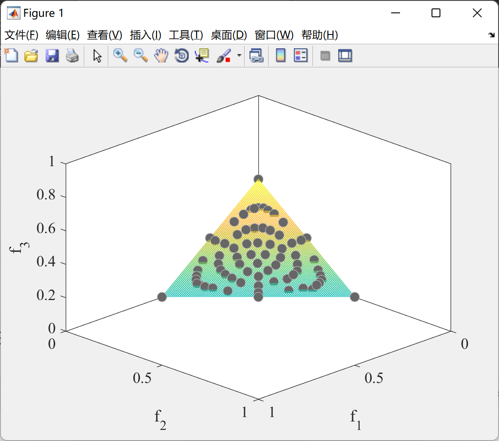
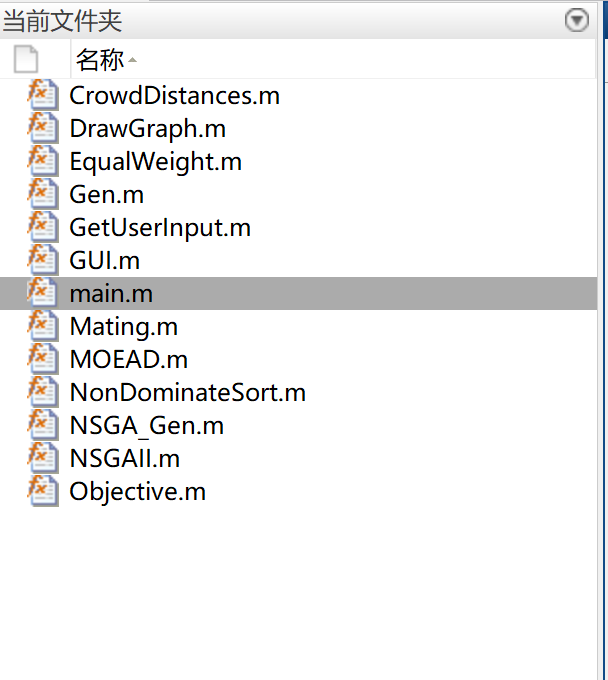

# NSGAII and MOEA-D algorithm Matlab codes

Both two-objective and three-objective problems can be solved. Below, we will take the three-objective example:
\n     \n      \n      \n      BiliBBS code rough explanation video address: https://www.bilibili.com/video/BV1uK4y1k7M1?spm_id_from=333.999.0.0

## Images

<!-- PAYMENT_BLOCK -->

## Get this dataset

- Payment link (Stripe): [Buy now](https://buy.stripe.com/3cs8yP7sY87d0vu9AB)
- Payment QR code: 

<!-- /PAYMENT_BLOCK -->
